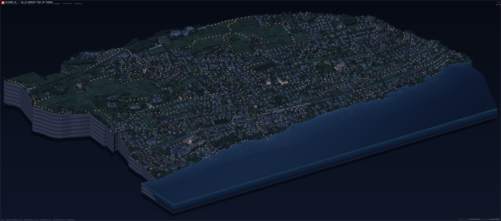
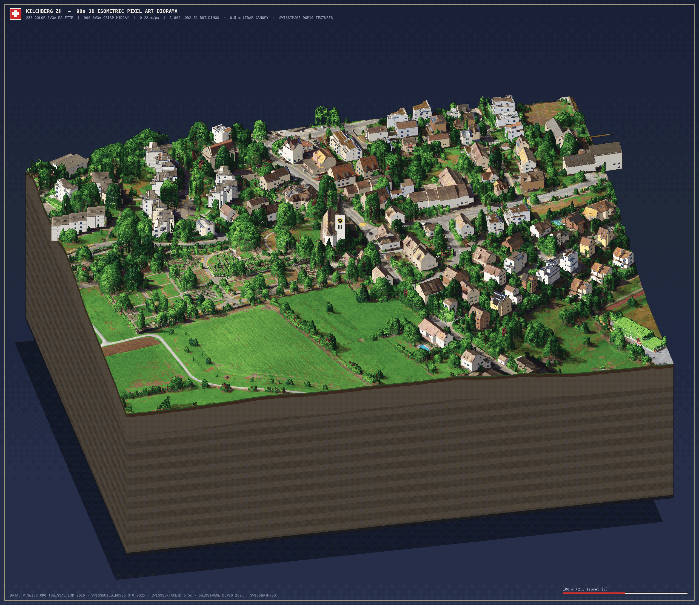
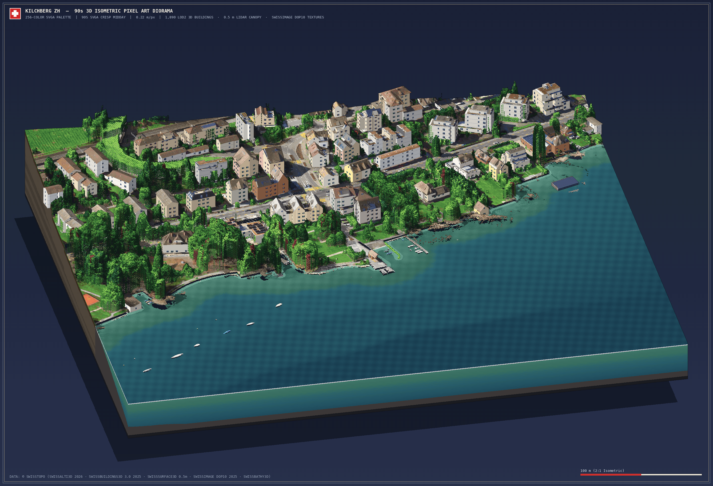
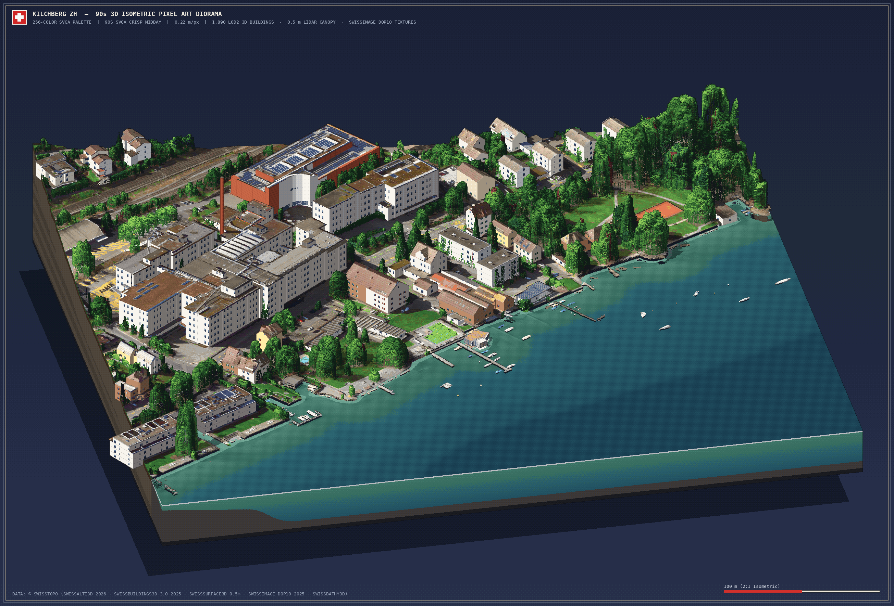

# Kilchberg ZH — 90s 3D Isometric Pixel Art Diorama (Ultra-HD `0.25 m/px` Edition)

**Live Interactive Deep-Zoom Explorer:** **[https://mad-greg.github.io/pixel-art/](https://mad-greg.github.io/pixel-art/)**

A meticulous, 100% data-accurate **90s 3D isometric pixel-art diorama of the Municipality of Kilchberg (ZH), Switzerland** (`BFS #0135`), built deterministically from **official Swiss Federal (`swisstopo`) public geospatial datasets** (`0.5 m` LiDAR terrain & 3D vegetation canopy, `LOD2` 3D CityGML building meshes, `10 cm` SWISSIMAGE DOP10 aerial orthophotos, and `swissTLM3D` / `swissBATHY3D` vector topography).


---

## Ultra-High-Fidelity Deep-Zoom Architecture (`~70 Megapixels` @ `0.25 m/px`)

Every single building, roof dormer, skylight, solar panel array, street marking, backyard swimming pool, moored sailboat, wooden pier, hedgerow, and tree crown across all `258.04 ha` of Kilchberg ZH is reconstructed in 3D isometric space and quantized into a **curated 256-color 90s SVGA palette** with `4×4` ordered Bayer dithering and `1px` selective pixel-art outlines (`sel-out`):

- **70-Megapixel Master Canvas (`~12,500 × 5,640 px` at `0.25 m/px`)** sliced into lossless `1024 × 1024` WebP tile pyramids (`docs/assets/tiles/{day,sunset,night}/`) for instant deep-zoom inspection up to `8×` native pixel magnification.
- **Three Lighting Presets**:
  1. **90s SVGA Crisp Midday** (`renders/kilchberg_diorama_day.png`)
  2. **Alpenglow Golden Sunset** (`renders/kilchberg_diorama_sunset.png`)
  3. **Zürichsee Lantern & Window-Lit Night** (`renders/kilchberg_diorama_night.png`)




---

## `0.22 m/px` Ultra-Detail 3D Isometric Landmark Plates

| Landmark Detail Plate (`0.22 m/px`) | Preview |
| :--- | :--- |
| **1. Lindt Home of Chocolate & Historic 1899 Factory**<br>Red clinker-brick base & white sculptural atrium, circular glass skylight roof, `43.6 m` brick smokestack (`Hochkamin`), cocoa silos, `Seebad Kilchberg` rafts & moored boats. |  |
| **2. Reformierte Kirche Kilchberg & Cemetery**<br>13th-century hilltop church (`550.5 m` spire crest & gilded tower clock), terraced cemetery (resting place of **Thomas Mann** & **Conrad Ferdinand Meyer**), and `Dorfstrasse`. |  |
| **3. Bendlikon Bay & ZSG Boat Pier (`Kilchberg ZH (See)`)**<br>Real harbor moorings, sailboats, wooden piers, `Navillepark`, and lakeside villas. |  |
| **4. SBB Bahnhof Kilchberg, Gemeindehaus & Vineyards**<br>`Seebahn` railway corridor, station platform canopies, town hall, and `Schlimberg` / `Stockengut` vineyards. |  |
| **5. Historic Schooren Quarter & Seebad Kilchberg**<br>1763 porcelain manufactory shoreline, lido floating sun-rafts, and `Navillepark` arboretum. |  |
| **6. Sanatorium Kilchberg & Terraced Parkland**<br>Historic 1906 pavilion campus amidst upper hillside woods above `Alte Landstrasse`. |  |

---

## Official Public Data Sources (`swisstopo` Open Government Data)

| Layer | Official Collection | Native Resolution | Modeled Elements in Kilchberg ZH |
| :--- | :--- | :--- | :--- |
| **Municipal Border** | `ch.swisstopo.swissboundaries3d` (2026) | Exact vector | `258.04 ha` land boundary (`BFS #0135`) + Lake Zurich aquarium prism |
| **Bare-Earth Terrain** | `ch.swisstopo.swissalti3d` (2026) | `0.5 m` LiDAR DTM | Terraces, motorway cut, ravines, shoreline (`405.95–545 m`) |
| **3D Canopy & Surface** | `ch.swisstopo.swisssurface3d-raster` (2024/25) | `0.5 m` LiDAR DSM | Exact volumetric 3D tree crowns, hedgerows, bushes & ray-marched shadows |
| **3D Buildings (LOD2)** | `ch.swisstopo.swissbuildings3d_3_0` (2025) | 3D CityGML | `1,890` buildings (`124,155` 3D roof & wall triangles), spires, silos & smokestack |
| **Aerial Orthophotos** | `ch.swisstopo.swissimage-dop10` (2025) | `10 cm` RGB | Per-pixel `25 cm` roof skylights/PV/tiles, streets, pools, piers & moored boats |
| **Streets, Rail & Lake** | `ch.swisstopo.base.vt` (`TLM3D` / `BATHY3D`) | Vector MVT | Surface streets & footpaths (tunnels excluded), SBB rail, pools & lake bathymetry |

---

## Interactive Deep-Zoom Web Explorer (`docs/`)

Open **[https://mad-greg.github.io/pixel-art/](https://mad-greg.github.io/pixel-art/)**:
- **Seamless Deep-Zoom `0.25 m/px` Tile Streaming** (`image-rendering: pixelated` up to `8×` native pixel zoom + `6×` pixel-grid loupe)
- **Full Multi-Device Panning**: Mouse drag, touchscreen 1-finger drag & 2-finger pinch-zoom, trackpad 2-finger pan (`Scroll: Pan` toggle or `Shift+Scroll`), interactive minimap drag, on-screen D-pad, and `WASD` / Arrow keys
- **Live Midday / Alpenglow / Night** lighting switcher preserving exact viewport position & zoom
- **Interactive LV95 GIS Building Inspector** across `1,800+` clickable 3D buildings + **10-Stop Guided Landmark Tour**

### Reproducing From Scratch

```bash
python3 -m venv .venv
source .venv/bin/activate
pip install -r requirements.txt

# 1. Fetch swisstopo tiles & build 0.5m / 25cm fused 3D caches
python -m pipeline.extract_scene

# 2. Render 0.25 m/px (~70 MP) Day, Sunset & Night tile pyramids + 0.22 m/px crops
python -m pipeline.render_all

# 3. Verify all outputs, tile manifests & GIS metadata
python -m pipeline.verify_quality
```
