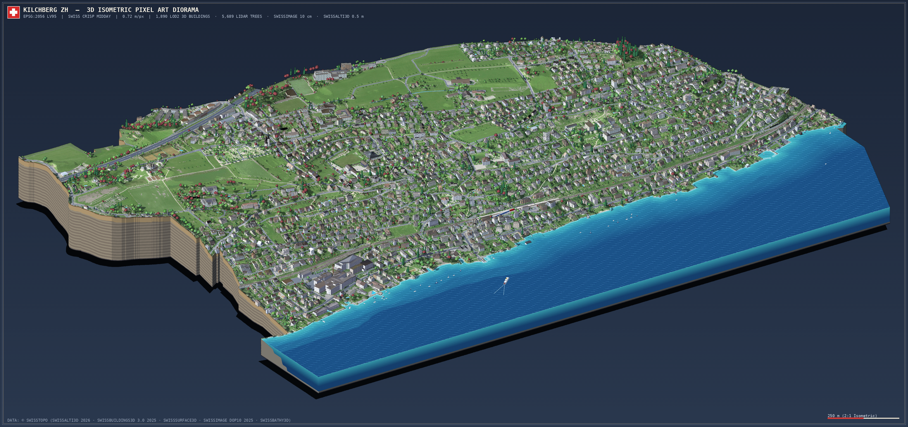
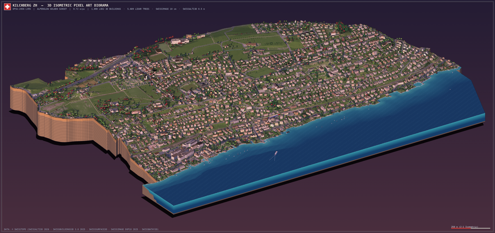
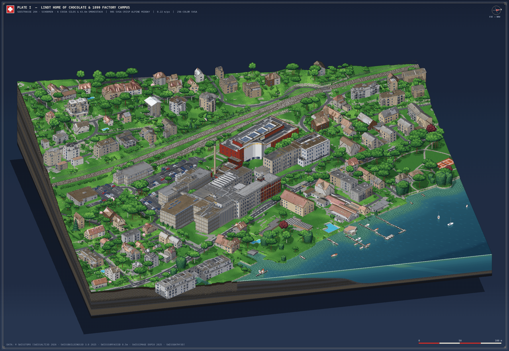
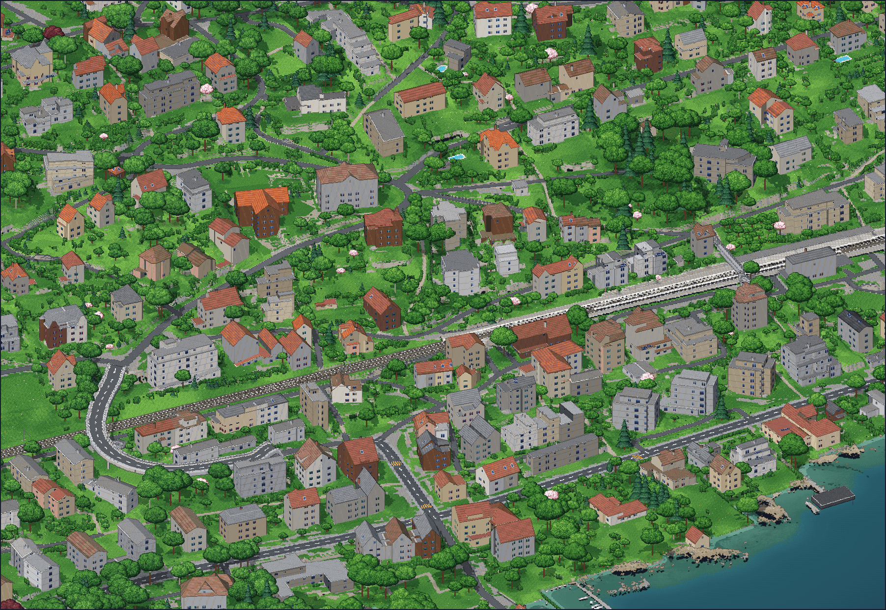
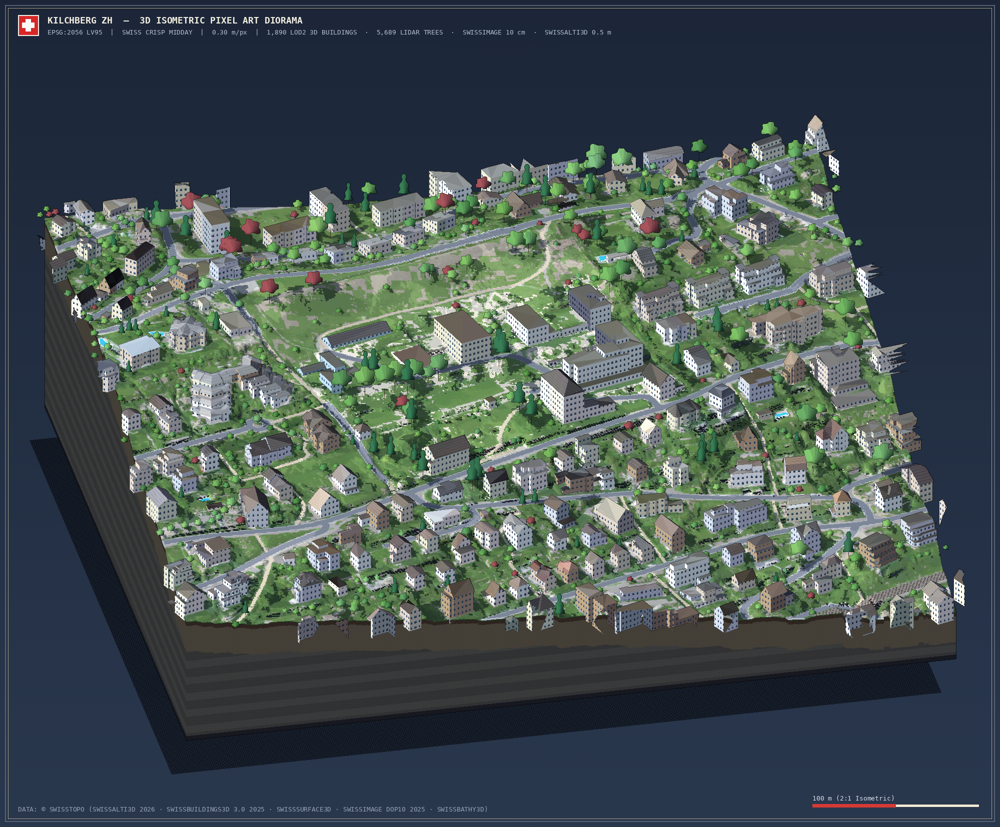

# Kilchberg ZH — 3D Isometric Pixel Art Diorama

An accurate, full-municipality **3D isometric pixel-art diorama of Kilchberg (ZH), Switzerland** (`BFS #0135`), generated deterministically from **100% official Swiss Federal (`swisstopo`) public geospatial data** (`0.5 m` LiDAR terrain & canopy, `LOD2` 3D CityGML building meshes, `10 cm` SWISSIMAGE aerial orthophotos, and `swissTLM3D` / `swissBATHY3D` vector topography).



---

## Three Lighting Modes (Full Municipality `4395 × 2071 px`, `0.72 m/px`)

### 1. Swiss Crisp Midday (`renders/kilchberg_diorama_day.png`)
Full daylight across the east-facing hillside from **Zürichsee (`405.95 m` a.s.l.)** up to the **Zimmerberg crest (`545 m` a.s.l.)**, featuring a carved geological cutaway of Upper Freshwater Molasse & Würm moraine strata and a translucent Lake Zurich bathymetric prism.

### 2. Alpenglow Golden Sunset (`renders/kilchberg_diorama_sunset.png`)


### 3. Zürichsee Lantern & Window-Lit Night (`renders/kilchberg_diorama_night.png`)


---

## `0.30 m/px` Ultra-Detail 3D Isometric Landmark Plates

Every roof plane, gable, church spire, factory smokestack, swimming pool, railway track, moored sailboat, and tree crown is placed at its exact **EPSG:2056 (`LV95 + LHN95`)** 3D coordinates:

| Landmark Detail Plate | Preview |
| :--- | :--- |
| **1. Lindt Home of Chocolate & Historic 1899 Factory**<br>Curved white limestone atrium, `43.6 m` historic brick smokestack (`Hochkamin`), cocoa silos, `Seebad Kilchberg`, and moored boats. |  |
| **2. Reformierte Kirche Kilchberg & Cemetery**<br>13th-century hilltop church (`550.5 m` spire crest), terraced cemetery (resting place of **Thomas Mann** & **Conrad Ferdinand Meyer**), and `Dorfstrasse`. |  |
| **3. Bendlikon Bay & ZSG Boat Pier (`Kilchberg ZH (See)`)**<br>ZSG passenger ship wake, harbor moorings, `Navillepark`, and lakeside villas. |  |
| **4. SBB Bahnhof Kilchberg, Gemeindehaus & Vineyards**<br>ZVV S-Bahn double-decker train on the `Seebahn`, town hall, and `Schlimberg` / `Stockengut` vineyards. |  |
| **5. Historic Schooren Quarter & Seebad Kilchberg**<br>Site of Switzerland's first porcelain manufactory (1763), lido swimming pool, and `Navillepark` copper beeches. |  |
| **6. Sanatorium Kilchberg & Terraced Parkland**<br>Historic 1906 pavilion estate amidst upper hillside woods above `Alte Landstrasse`. |  |

---

## Official Public Data Sources (`swisstopo` Open Government Data)

| Layer | Official Collection | Native Resolution | Modeled Elements in Kilchberg ZH |
| :--- | :--- | :--- | :--- |
| **Municipal Border** | `ch.swisstopo.swissboundaries3d` (2026) | Exact vector | `258.04 ha` land boundary (`BFS #0135`) |
| **Bare-Earth Terrain** | `ch.swisstopo.swissalti3d` (2026) | `0.5 m` LiDAR DTM | Terraces, motorway cut, ravines, shoreline (`405.95–545 m`) |
| **Surface & Canopy** | `ch.swisstopo.swisssurface3d-raster` (2024/25) | `0.5 m` LiDAR DSM | `5,689` individual 3D tree crowns + exact ray-marched LiDAR sun shadows |
| **3D Buildings (LOD2)** | `ch.swisstopo.swissbuildings3d_3_0` (2025) | 3D CityGML | `1,890` buildings (`124,155` 3D roof & wall triangles), spires, silos & smokestack |
| **Aerial / Satellite** | `ch.swisstopo.swissimage-dop10` (2025) | `10 cm` RGB | True roof tile colors, courtyards, clay courts, copper beeches & `46` moored boats |
| **Streets, Rail & Lake** | `ch.swisstopo.base.vt` (`TLM3D` / `BATHY3D`) | Vector MVT | Surface streets & footpaths (tunnels excluded), SBB railway, 230 pools & lake bathymetry |

---

## Interactive Web Explorer (`docs/`)

The repository includes a zero-dependency interactive pixel-art explorer in [`docs/`](docs/index.html) (configured for **GitHub Pages**):
- **Crisp `image-rendering: pixelated` pan & zoom** with integer `1×` / `2×` pixel snap and a **6× pixel-grid loupe**
- **Live Midday / Alpenglow / Night** lighting switcher
- **Interactive LV95 GIS Building Inspector** (click any of the `1,800+` 3D buildings to inspect its street address, ground & roof-ridge elevation, height, and sampled `SWISSIMAGE` roof RGB)
- **10-Stop Guided Tour** of Kilchberg ZH

### Reproducing From Scratch

```bash
python3 -m venv .venv
source .venv/bin/activate
pip install -r requirements.txt

# 1. Fetch swisstopo tiles & extract 0.5m fused 3D scene
python -m pipeline.extract_scene

# 2. Render Day, Sunset, Night 3D isometric dioramas + 6 ultra-detail crops + web assets
python -m pipeline.render_all

# 3. Verify outputs
python -m pipeline.verify_quality
```
